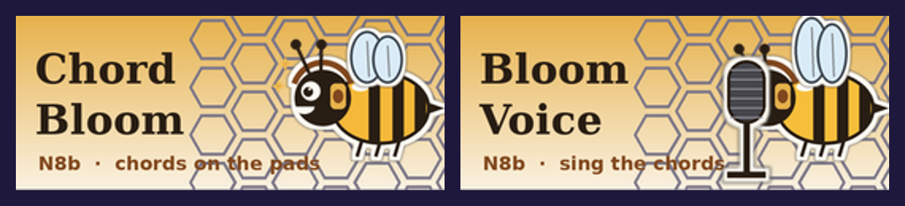
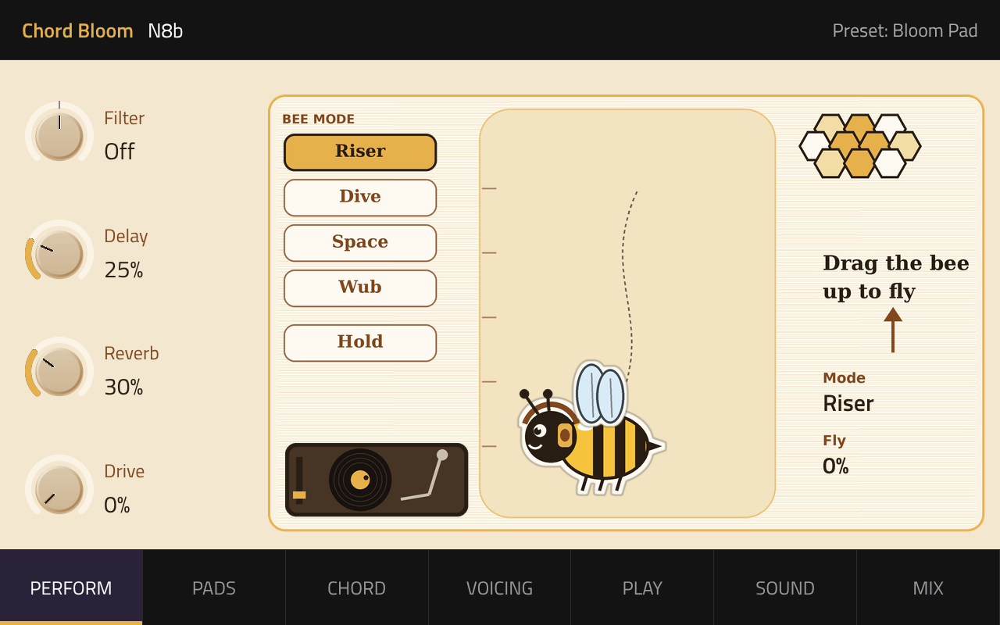
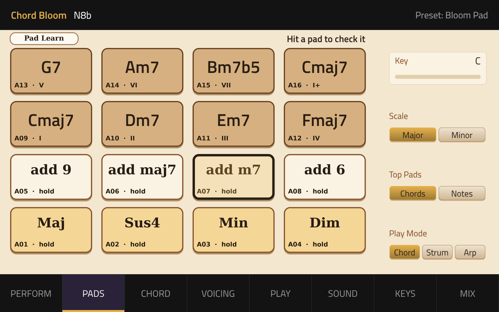
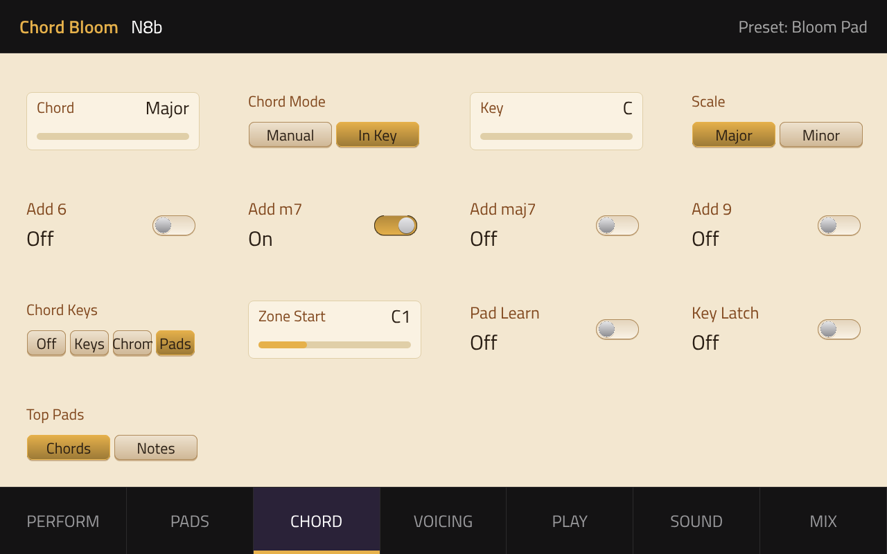
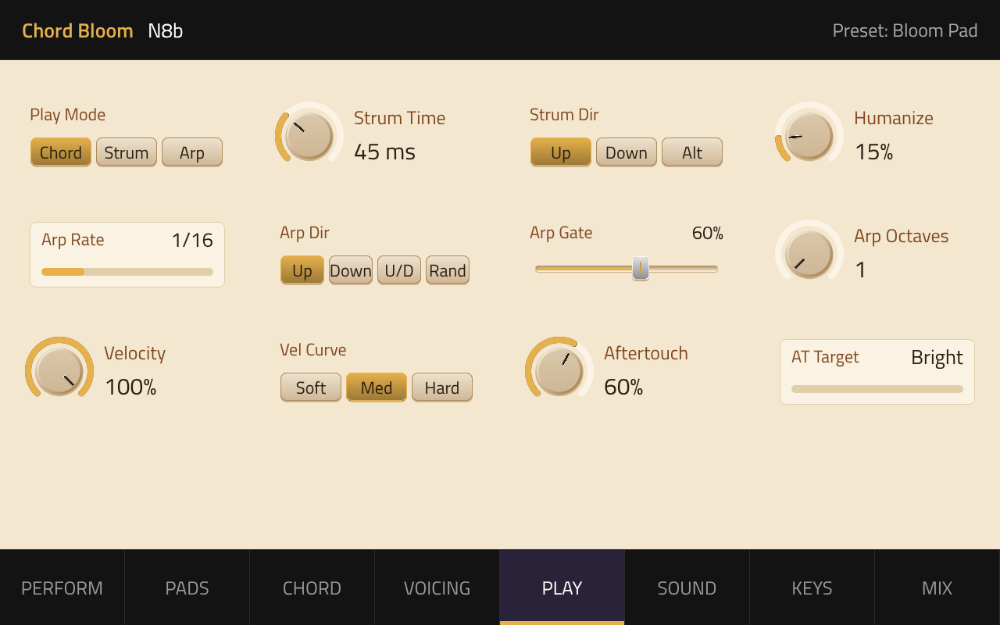
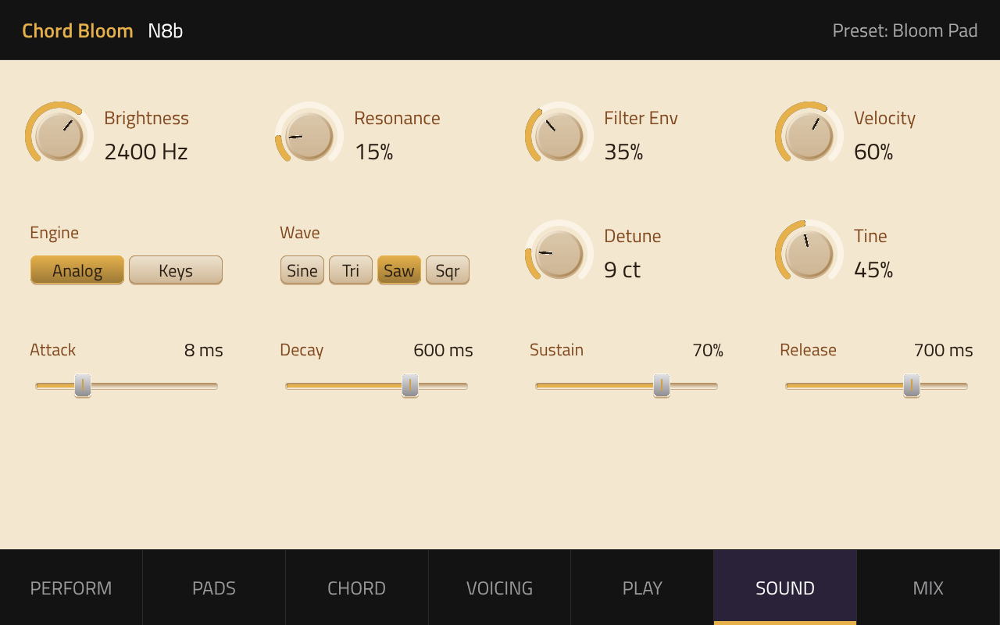
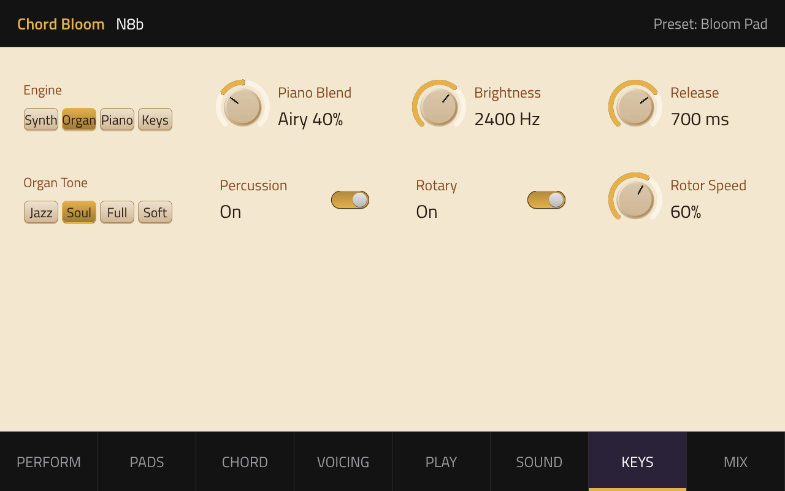
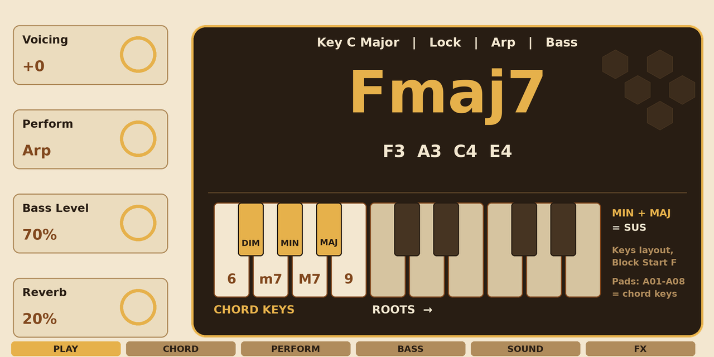

# N8b MPC Instruments

Instruments and effects for Akai MPC standalone hardware (MPC Live, One, Key, X), made with the MPC OS 3.10.1 Plugin SDK. Made by N8b.

| | What it is | Version |
|---|---|---|
| [**Chord Bloom**](chord-bloom/) | One-finger chord instrument: hold a chord type, tap a root, get a full chord. Synth, organ, piano and keys sounds, strum and arp, performance FX with a dancing bee. | 1.4.1 |
| [**Bloom Voice**](bloom-voice/) | 16-band vocoder that goes with Chord Bloom: sing into a mic and your voice plays the chords. | 1.0.0 |
| [**Honey Root**](honey-root/) | Two-handed chord machine for a keyboard like the M-Vave SMK-37: chord keys under the left hand, roots under the right, Lock, voicing, Key Mode, a bass line that follows, strum, arp, pattern and harp. | 1.0.0 |

## Hear it

- [Chord Bloom demo](media/audio/chord-bloom-demo.mp3)
- [Organ and piano demo](media/audio/organ-piano-demo.mp3)
- [Bloom Voice test](media/audio/bloom-voice-test.mp3)
- [Honey Root demo](media/audio/honey-root-demo.mp3)

## Install on your MPC

1. Download the zips: [Chord Bloom 1.4.1](downloads/chord-bloom-1.4.1-mpc.zip), [Bloom Voice 1.0.0](downloads/bloom-voice-1.0.0-mpc.zip) and [Honey Root 1.0.0](downloads/honey-root-1.0.0-mpc.zip) (on the file's page, tap the download button).
2. Unzip them on your computer. Each one gives you a folder named like `N8b - VST - Chord Bloom`.
3. On a USB stick or SD card, make a folder called `VST2 Plugins` at the top level (not inside another folder), and put those folders in it.
4. Put the drive in your MPC. Go to **Preferences > Enhancements (Beta)** and turn on **Enable Enhancements** and **External Plugin Support**.
5. Restart the MPC. Chord Bloom and Honey Root show up with the instrument plugins, Bloom Voice with the effects.

Needs MPC OS 3.10.1 or later.

## Screens

| PERFORM | PADS |
|---|---|
|  |  |
| **CHORD** | **PLAY** |
|  |  |
| **SOUND** | **KEYS** |
|  |  |

| **Honey Root PLAY** | |
|  | |

These are close mock-ups of the on-device screens.

## For builders

Each folder holds the plugin's source (`src/`), its `plugin.json` and `ui.json`, and a `post_build.py` that adds the custom artwork. To build, use Akai's [MPC Plugin Builder SDK](https://github.com/inmusic-software/mpc-plugin-builder-sdk); the steps are in each plugin's README. The [Open MPC](https://github.com/open-mpc/mpc-vst-plugins) notes were a big help.

## Licence

MIT. See [LICENSE](LICENSE).
